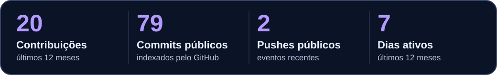

# Código para operações em movimento

Sou **Edvam Santos**, desenvolvedor full stack e criador da **Nikluma**. Gosto de seguir um problema de ponta a ponta. Posso começar investigando por que dois sistemas discordam sobre uma entrega e terminar desenhando a tela que ajuda alguém a decidir o que fazer com essa informação.

[**Atividade**](#atividade-no-github) · [**Stack**](#minha-stack) · [**Engenharia**](#como-eu-construo) · [**Arcade**](#mitocoder-arcade) · [**Nikluma ↗**](https://www.nikluma.com.br/)

## Atividade no GitHub

Como os números são contados

- **Contribuições e dias ativos** vêm do calendário visível no perfil. Um dia ativo tem pelo menos uma contribuição registrada pelo GitHub.
- **Commits públicos** são os resultados que o GitHub indexa para meu usuário como autor.
- **Pushes públicos** são os eventos do tipo push que aparecem no feed recente do GitHub, limitado a 30 dias e 300 eventos públicos. Um push pode transportar vários commits.

## Minha stack

| Área | Tecnologias |
| :--- | :--- |
| **Linguagens** | JavaScript · TypeScript · Python · C# · SQL |
| **Interfaces** | React · HTML · CSS · Material UI · Ant Design |
| **Backend e dados** | Node.js · Express · APIs REST · MySQL · MongoDB · SQLite |
| **Ferramentas** | Git · GitHub · VS Code · Figma |

## Como eu construo

**Integrações.** Quando dois sistemas descrevem a mesma operação, eu começo pelas perguntas difíceis: qual deles é a fonte de cada dado, o que acontece se um evento chegar duas vezes e como a equipe identifica uma sincronização atrasada?

**Interfaces operacionais.** Gosto de desenhar telas a partir da decisão que a pessoa precisa tomar. Numa exceção logística, a nota afetada, a última ocorrência e o horário da informação ajudam a decidir o próximo passo.

**Dados que dão para conferir.** Um indicador ganha valor quando é possível seguir o número até os registros que o formaram. Em uma prestação de contas, esse caminho vai do saldo ao lançamento e, quando a pessoa tem acesso, ao documento que o sustenta.

Na [**Nikluma**](https://www.nikluma.com.br/) trabalho com esses problemas em automação de processos. O [Control Tower](https://www.nikluma.com.br/produto/control-tower/) acompanha exceções na logística, e o [TH Contábil](https://www.nikluma.com.br/solucoes/th-contabil/) reúne informações para a prestação de contas condominial.

## MitoCoder Arcade

### Desafio rápido · O webhook fantasma

Seu sistema recebeu o mesmo aviso de entrega três vezes. Cada requisição chega em um processo diferente, e a operação precisa registrar a entrega uma única vez. **Qual jogada você faz?**

A · Ignorar requisições com menos de um segundo de diferença

**Perdeu uma vida.** Uma repetição pode chegar minutos depois. Duas entregas diferentes também podem chegar no mesmo segundo.

B · Gravar o ID do evento com uma restrição única no banco

**Fase concluída.** Guarde uma chave única para o evento e registre a entrega na mesma transação. Se duas requisições correrem juntas, o banco impede a duplicação, e a segunda pode confirmar o recebimento com segurança.

C · Guardar os IDs já vistos na memória do servidor

**Reinicie a fase.** Cada processo tem sua própria memória. Depois de um restart, os IDs lembrados por aquele processo somem.

---

**Edvam Santos · MitoCoder**

[nikluma.com.br ↗](https://www.nikluma.com.br/) · [Instagram ↗](https://www.instagram.com/mycosmus/)
